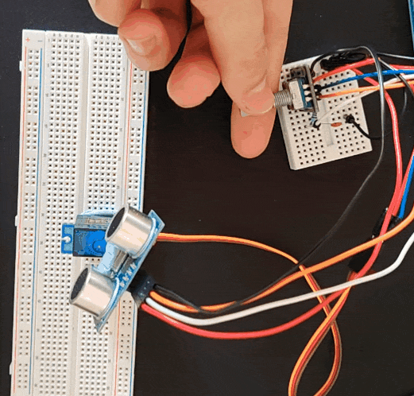

# Ultrasonic-Distance-Detector-with-Controls
> **Implementation Note:** Code was written from scratch by me using ATmega 2560 standard AVR libraries along with the UART protocol which are also available in my documentation and 1 C library for console outputs. Direct register manipulation was performed using my own ATmega 2560 memory register map, [linked here](https://github.com/RaresCM/ATMega2560-Custom-Documentation).

## Overview
This is my custom designed 'radar' using a ultrasonic sensor, servo motor and encoder. It uses interrupts for my encoder input and a custom UART protocol to output the distance and heading from 0 degrees to a console.

## Key Features
This project was built to apply concepts from my EEE course as well as module integration and features:
* Custom UART protocol to talk to a PC console for angle and distance outputs to a console
* 4 meter range ultrasonic sensor
* Rotary encoder to move the sensor left and right +90 or -90 degrees
* Interrupts to ensure all encoder inputs are detected
* Hard center logic for the encoder button press function

## Issues and possible improvements 

One issue with this is a servo jitter I have been able to reduce using a RC filter in hardware but still is not perfect resulting in some jitter during high rate inputs to the encoder. I suspect my ISR function for the encoder may need a tiny delay to stop this.

## Repository Structure
- /main.c - The main code for the clock to be uploaded to the chip
- /platformio.ini - PlatformIO settings to be used with VS code and PlatformIO extension
- /designlog.md - My log of findings, learning and obstacles encountered during the design of the alarm clock
